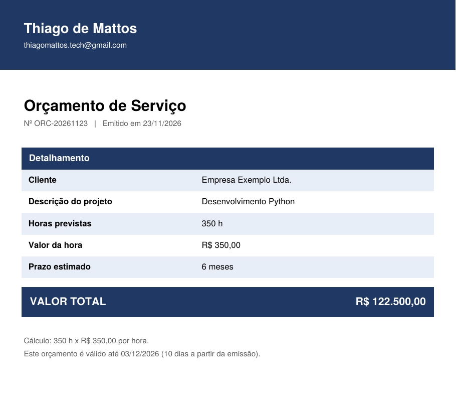

# 📄 Gerador de Orçamento em PDF

> Automação em Python que transforma os dados de um projeto (horas, valor da hora e prazo) em um orçamento profissional em PDF, com validação das entradas e valores no padrão brasileiro.


---

## 📌 O problema

Montar orçamentos à mão é repetitivo e sujeito a erro: digitar os dados, calcular o total, formatar valores em reais e manter o mesmo visual em todos os documentos. Este projeto automatiza o processo inteiro: você informa os dados e o PDF sai pronto em segundos.

## ⚙️ Como funciona

```
Entrada (input)  →  Validação  →  Cálculo  →  PDF
cliente, projeto,    números em     horas ×      layout próprio:
horas, valor/hora,   padrão BR,     valor/hora   cabeçalho, tabela,
prazo                campos vazios               total em R$ e validade
```

| Etapa | Função em `orcamento.py` | O que faz |
|---|---|---|
| Entrada | `ler_numero()` | Aceita `350`, `350,50`, `350.50`, `1.234,56` e `R$ 1.234,56` |
| Validação | `criar_orcamento()` | Recusa campos vazios, textos que não são número e valores ≤ 0, com mensagens claras |
| Cálculo | `Orcamento.valor_total` | Horas previstas × valor da hora, arredondado em 2 casas |
| Formatação | `formatar_moeda()` | `122500` → `R$ 122.500,00` |
| Saída | `gerar_pdf()` | Desenha o PDF em A4 e salva com nome único (`Orcamento_<projeto>_<data>.pdf`) |

## 🧾 O que vai no PDF



*Exemplo real gerado com 350 h × R$ 350,00.*


- Cabeçalho com nome e contato de quem emite
- Número do orçamento e data de emissão
- Tabela com cliente, descrição do projeto, horas, valor da hora e prazo
- **Valor total em destaque**
- Memória de cálculo e data de validade (10 dias por padrão)

## 🆕 Evolução do projeto

| Versão 2.0 | Versão 3.0 |
|---|---|
| Total sem formatação (`122500`) | **R$ 122.500,00** |
| Só aceitava ponto como decimal | Aceita vírgula e separador de milhar |
| Dependia de uma imagem de fundo e de coordenadas fixas | Layout desenhado em código |
| Arquivo sempre com o mesmo nome | Nome com projeto e data, sem sobrescrever |
| Tudo dentro do notebook | Módulo reutilizável + testes automatizados |

## 🚀 Como executar

```bash
git clone https://github.com/THMattos/gerador-orcamento-pdf.git
cd gerador-orcamento-pdf

python -m venv .venv
.venv\Scripts\activate            # Linux/macOS: source .venv/bin/activate

pip install -r requirements.txt
jupyter notebook Gerador_de_Orcamento.ipynb
```

Ou direto em Python:

```python
from orcamento import criar_orcamento, gerar_pdf

orc = criar_orcamento("Empresa Exemplo", "Desenvolvimento Python", "350", "350", "6 meses")
print(gerar_pdf(orc, pasta_saida="orcamentos"))
```

## 🧪 Testes

As regras de entrada, cálculo e formatação têm testes automatizados, que rodam sem precisar gerar PDF:

```bash
pip install pytest
python -m pytest
```

## 📁 Estrutura

```
gerador-orcamento-pdf/
├── orcamento.py                # regras, validação e geração do PDF
├── Gerador_de_Orcamento.ipynb  # passo a passo interativo
├── tests/
│   └── test_orcamento.py       # testes com pytest
├── exemplo-orcamento.png       # prévia do PDF gerado
├── requirements.txt
└── README.md
```

## 🔭 Próximos passos

- Vários itens por orçamento (tabela com linhas de serviço)
- Logo da empresa e dados de contato configuráveis
- Envio do PDF por e-mail ou integração com n8n

## 👤 Autor

**Thiago de Mattos**: Estudante de Engenharia de Software
🔗 [LinkedIn](https://www.linkedin.com/in/thiago-demattos-rj/) · 💻 [GitHub](https://github.com/THMattos)
